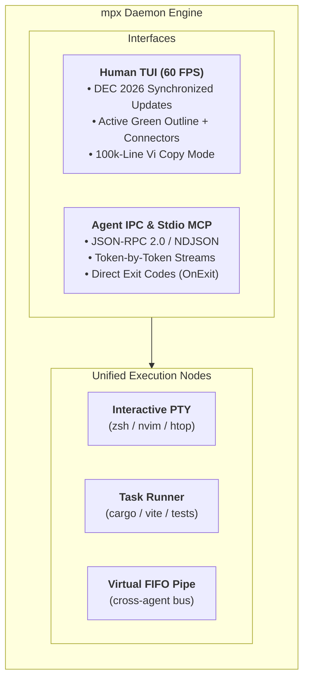

# mpx

[](https://crates.io/crates/mpx)
[](https://github.com/casonadams/mpx/actions/workflows/ci.yml)
[](LICENSE)
[](https://casonadams.github.io/mpx/)

A simple, ultra-performant process and stream multiplexer in Rust. Built from first principles for human developers collaborating side-by-side with autonomous AI coding agents (`oh-my-pi`, `claude code`).

> **100% Local & Zero Telemetry**: `mpx` is an offline-by-design terminal engine. It contains **zero network calls, zero analytics, zero telemetry, and zero model training**. Your commands, keystrokes, and source code never leave your machine. It operates purely over local Unix domain sockets or Windows Named Pipes, streaming structured JSON-RPC or stdio MCP to whichever agent harness or workflow engine *you* choose to run.

---

## What Sets `mpx` Apart?

Traditional terminal multiplexers were designed in the 1990s and 2000s under the assumption that every pane is an interactive login shell inside a PTY:

- **`tmux`**: Ubiquitous and lightweight (~5MB), but constrained by 30-year-old PTY assumptions. AI agents are forced to scrape raw ANSI strings from `capture-pane`, sleep-poll heuristic loops, and inject fake keystrokes via `send-keys`.
- **`zellij`**: Proven human ergonomics, but heavyweight (~60–120MB idle RAM, 30MB+ binary size), bounces bytes across multi-actor thread hops, and includes heavy WebAssembly runtimes with no native structured agent protocol.

**`mpx` replaces the legacy PTY restriction with Unified Stream Nodes**:



| Dimension | `tmux` | `zellij` | `mpx` |
| :--- | :--- | :--- | :--- |
| **Language** | C (libevent) | Rust (multi-thread actor + async-std) | **Rust (Tokio async)** |
| **Idle Memory** | ~5 MB | ~60–120 MB | **~5 MB** |
| **WASM Runtime** | None | Yes (wasmer/WASI) | **None (Zero Bloat)** |
| **Agent Automation** | `send-keys` / `capture-pane` scraping | WASM Plugin API / CLI | **Native Stdio MCP + Socket JSON-RPC** |
| **Process Units** | Interactive PTY only | PTY + WASM Plugins | **PTY + Pipe Tasks + Virtual Channels** |
| **Stream Storage** | VT screen grid only | VT screen grid only | **Dual Buffer (Raw Stream + 2D Grid)** |
| **Windows Support** | Cygwin / WSL required | WSL required | **Native (Windows Named Pipes + ConPTY)** |
| **Telemetry** | None | None | **100% Offline (Zero Telemetry)** |

---

## Quickstart

### Installation

```bash
# macOS & Linux (Homebrew)
brew install casonadams/tap/mpx

# Ubuntu & Debian (APT)
echo "deb [trusted=yes] https://casonadams.github.io/homebrew-tap/apt stable main" | sudo tee /etc/apt/sources.list.d/casonadams.list
sudo apt update && sudo apt install mpx

# Fedora & RHEL (DNF)
curl -fsSL https://casonadams.github.io/homebrew-tap/rpm/casonadams.repo | sudo tee /etc/yum.repos.d/casonadams.repo
sudo dnf install mpx

# Cargo (crates.io)
cargo binstall mpx || cargo install mpx
```

See **[Installation Guide](docs/INSTALL.md)** for prebuilt `.deb`, `.rpm`, `.tar.gz`, and Windows `.zip` archives.

---

### 30-Second Tour

```bash
# 1. Start or attach to the default session "main" (Ctrl-b prefix, tmux keys)
mpx

# 2. Run a background watcher without nesting shells
mpx run --name test-watcher -- cargo watch -x test

# 3. List sessions (tmux `ls`) and panes with exit codes
mpx ls
mpx list-panes

# 4. Stream logs, or wait for a regex instead of sleep-polling
mpx logs -f test-watcher
mpx wait test-watcher --match 'test result: ok' --timeout 120

# 5. Split a pane without stealing focus (tmux -h / -d)
mpx split -h -d --pty -- htop

# 6. Launch an agent beside you, then manage all agents (Prefix s)
mpx agents new claude --split
```

---

## Agent Manager

`Prefix s` (or `mpx agents`) lists every AI agent running in any session (Claude Code, oh-my-pi, Codex, rho, or your own harness). Agents are grouped by state (**needs you**, working, idle, exited), next to stored sessions you can resume. You can jump to an agent, resume or launch one, message several at once, or kill them, all with vim keys. `Prefix e` opens an agents sidebar: every agent by session down the left, with the highlighted agent's pane live on the right. `Prefix A` jumps to the agent that has waited longest, and the status bar shows `◆N` while agents wait. State comes from harness hooks that mpx installs when it launches an agent, with terminal bells and output activity as fallbacks. See **[Agent Manager](docs/AGENT-MANAGER.md)**.

**tmux compatibility**: invoked as `tmux`, the mpx binary translates `split-window`, `send-keys`, `capture-pane`, `list-panes` and friends. With `mpx agents new claude --teams`, Claude Code agent teams spawn their teammates as mpx panes.

**Survives crashes and reboots**: the daemon snapshots the layout continuously. After a crash or reboot, the session comes back with its windows, splits and working directories, and each agent resumes its own conversation (`claude --resume`, `omp --resume`, `rho --resume`). Pipe messages persist too. Run `mpx restore` to bring back a session you stopped on purpose. See **[Session restore](docs/CLI.md#session-restore)**.

---

## AI Agent Integration (Model Context Protocol)

`mpx` ships with an embedded, zero-dependency stdio MCP server. Add `mpx` directly to your agent's `.mcp.json` (`oh-my-pi`, `claude code`, Cursor, Windsurf):

```json
{
  "mcpServers": {
    "mpx": {
      "command": "mpx",
      "args": ["mcp"]
    }
  }
}
```

Agents gain 23 tools: run and wait for processes (exit, quiet output, regex, agent state), read output incrementally, send tmux key names or bracketed pastes, exchange sequenced messages through durable pipes with per-consumer cursors, launch and prompt other agents (`mpx_agent_launch`, `mpx_agent_prompt`), see what other agents in the same repository are working on (`mpx_peers`), and restore sessions. Agents mpx launches get these tools automatically and are told when other agents share their repository; see [Agent awareness](docs/AGENT-MANAGER.md#agent-awareness). Mutating tools accept an `idempotency_key`, so retries never act twice. Every mpx pane exports `MPX_SESSION`/`MPX_ENDPOINT`, so an agent inside mpx manages its own session automatically. See **[MCP Guide](docs/MCP.md)** for full workflows.

---

## Documentation

- **[Architecture & Design](docs/ARCHITECTURE.md)**: Stream nodes, agent tracking, workspace, pipes, and TUI.
- **[CLI Reference & Automation](docs/CLI.md)**: tmux-style commands, waiting, pipes, and the tmux shim.
- **[Keyboard Shortcuts](docs/KEYBINDINGS.md)**: Prefix bindings, `:` command prompt with vim aliases, overlays, and copy mode.
- **[Agent Manager](docs/AGENT-MANAGER.md)**: Find, jump to, resume, launch, and message agent sessions.
- **[Configuration](docs/CONFIG.md)**: Prefix, key bindings, `remain_on_exit`, and agent harnesses.
- **[Model Context Protocol (MCP)](docs/MCP.md)**: Agent configuration, tools catalog, and agent-to-agent workflows.
- **[Installation Guide](docs/INSTALL.md)**: Package managers, static archives, and cross-platform builds.
- **[Interactive Website](https://casonadams.github.io/mpx/)**: Online visual demo and live documentation.

---

## License

Licensed under the [Apache License, Version 2.0](LICENSE).
