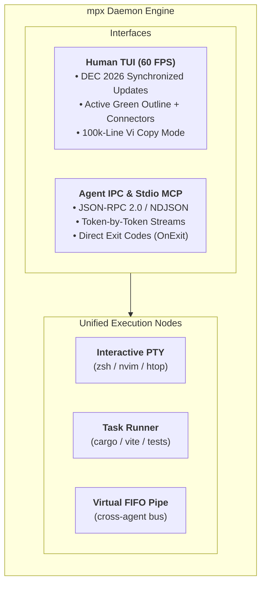

# mpx

[](https://crates.io/crates/mpx)
[](https://github.com/casonadams/mpx/actions/workflows/ci.yml)
[](LICENSE)
[](https://casonadams.github.io/mpx/)

A simple, ultra-performant process and stream multiplexer in Rust. Built from first principles for human developers collaborating side-by-side with autonomous AI coding agents (`oh-my-pi`, `claude code`).

> **100% Local & Zero Telemetry**: `mpx` is an offline-by-design terminal engine. It contains **zero network calls, zero analytics, zero telemetry, and zero model training**. Your commands, keystrokes, and source code never leave your machine. It operates purely over local Unix domain sockets or Windows Named Pipes, streaming structured JSON-RPC or stdio MCP to whichever agent harness or workflow engine *you* choose to run.

---

## What Sets `mpx` Apart?

Traditional terminal multiplexers were designed in the 1990s and 2000s under the assumption that every pane is an interactive login shell inside a PTY:

- **`tmux`**: Ubiquitous and lightweight (~5MB), but constrained by 30-year-old PTY assumptions. AI agents are forced to scrape raw ANSI strings from `capture-pane`, sleep-poll heuristic loops, and inject fake keystrokes via `send-keys`.
- **`zellij`**: Proven human ergonomics, but heavyweight (~60–120MB idle RAM, 30MB+ binary size), bounces bytes across multi-actor thread hops, and includes heavy WebAssembly runtimes with no native structured agent protocol.

**`mpx` replaces the legacy PTY restriction with Unified Stream Nodes**:



| Dimension | `tmux` | `zellij` | `mpx` |
| :--- | :--- | :--- | :--- |
| **Language** | C (libevent) | Rust (multi-thread actor + async-std) | **Rust (Tokio async)** |
| **Idle Memory** | ~5 MB | ~60–120 MB | **~5 MB** |
| **WASM Runtime** | None | Yes (wasmer/WASI) | **None (Zero Bloat)** |
| **Agent Automation** | `send-keys` / `capture-pane` scraping | WASM Plugin API / CLI | **Native Stdio MCP + Socket JSON-RPC** |
| **Process Units** | Interactive PTY only | PTY + WASM Plugins | **PTY + Pipe Tasks + Virtual Channels** |
| **Stream Storage** | VT screen grid only | VT screen grid only | **Dual Buffer (Raw Stream + 2D Grid)** |
| **Windows Support** | Cygwin / WSL required | WSL required | **Native (Windows Named Pipes + ConPTY)** |
| **Telemetry** | None | None | **100% Offline (Zero Telemetry)** |

---

## Quickstart

### Installation

```bash
# macOS & Linux (Homebrew)
brew install casonadams/tap/mpx

# Ubuntu & Debian (APT)
echo "deb [trusted=yes] https://casonadams.github.io/homebrew-tap/apt stable main" | sudo tee /etc/apt/sources.list.d/casonadams.list
sudo apt update && sudo apt install mpx

# Fedora & RHEL (DNF)
curl -fsSL https://casonadams.github.io/homebrew-tap/rpm/casonadams.repo | sudo tee /etc/yum.repos.d/casonadams.repo
sudo dnf install mpx

# Cargo (crates.io)
cargo binstall mpx || cargo install mpx
```

See **[Installation Guide](docs/INSTALL.md)** for prebuilt `.deb`, `.rpm`, `.tar.gz`, and Windows `.zip` archives.

---

### 30-Second Tour

```bash
# 1. Start or attach to default session "main" (tmux muscle-memory)
mpx

# 2. Run a background watcher without nesting shells
mpx run --name "test-watcher" -- cargo watch -x test

# 3. List running nodes and inspect exit codes
mpx list

# 4. Stream unpolluted logs in real-time (no escape code scraping)
mpx logs -f test-watcher

# 5. Split pane without stealing focus
mpx split --detach --name "htop" -- htop
```

---

## AI Agent Integration (Model Context Protocol)

`mpx` ships with an embedded, zero-dependency stdio MCP server. Add `mpx` directly to your agent's `.mcp.json` (`oh-my-pi`, `claude code`, Cursor, Windsurf):

```json
{
  "mcpServers": {
    "mpx": {
      "command": "mpx",
      "args": ["mcp"]
    }
  }
}
```

Agents gain access to 12 deterministic tools (`mpx_run`, `mpx_status`, `mpx_read`, `mpx_split`, `mpx_wait`, `mpx_pipe_write`) to launch build tools, monitor background tasks, and split developer panes without terminal scraping. See **[MCP Guide](docs/MCP.md)** for full workflows.

---

## Documentation

- **[Architecture & Design](docs/ARCHITECTURE.md)**: Dual-buffer engine, stream nodes, and atomic synchronization.
- **[CLI Reference & Automation](docs/CLI.md)**: Full command manual, flags, and scripting recipes.
- **[Keyboard Shortcuts & Vi Mode](docs/KEYBINDINGS.md)**: Leader keys (`Ctrl-B` / `Ctrl-A`), splits, directional navigation, and copy mode.
- **[Model Context Protocol (MCP)](docs/MCP.md)**: Agent configuration, tools catalog, and inter-agent virtual pipes.
- **[Installation Guide](docs/INSTALL.md)**: Package managers, static archives, and cross-platform builds.
- **[Interactive Website](https://casonadams.github.io/mpx/)**: Online visual demo and live documentation.

---

## License

Licensed under the [Apache License, Version 2.0](LICENSE).
