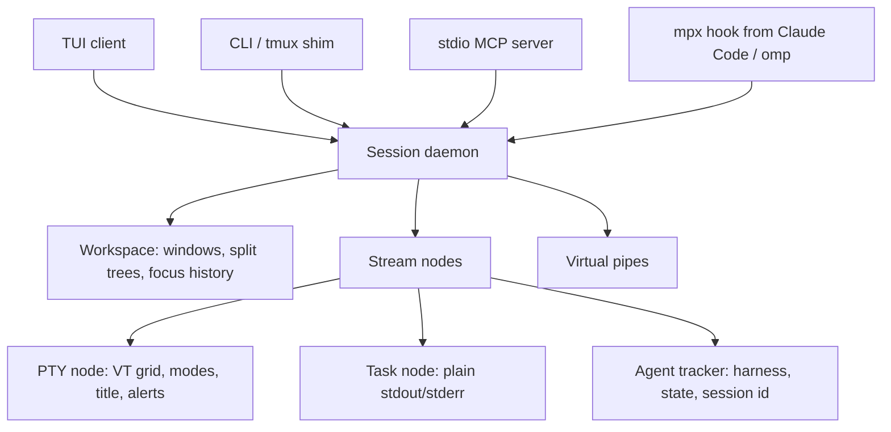

# Architecture & Design

`mpx` is a Rust / Tokio daemon per session, plus thin clients: the TUI, the CLI, the stdio MCP server, and the `tmux` shim. All of them speak the same newline-delimited JSON protocol (`src/protocol.rs`) over a Unix domain socket or Windows Named Pipe.

---

## 1. Stream nodes

Every pane is a **node** with a stable id (`%N`):

1. **PTY** (`--pty`): a full terminal (POSIX PTY or ConPTY) mirrored into a VT grid. The grid tracks the program's input modes (cursor keys, bracketed paste, focus events), window title (OSC 0/2) and alerts (BEL, OSC 9/777).
2. **Task**: a child process with captured stdout/stderr and no terminal emulation.

Each node gets `MPX_ENDPOINT`, `MPX_SESSION`, `MPX_PANE` and `MPX_PANE_ID` in its environment, so programs inside a pane (agents, scripts, `mpx` itself) address their own session. With tmux compatibility, `TMUX`, `TMUX_PANE` and the shim directory on `PATH` are added.

Output goes into a ring buffer with **absolute byte offsets**, so readers can poll incrementally (`logs --since`, MCP `mpx_read`) without rereading. PTY scrollback is also available as plain rendered text.

## 2. Agent tracking

For each node, the daemon reads the PTY foreground process (comm and argv) to recognize agent harnesses. It keeps a small state machine (`src/node/agent.rs`):

- Hook reports (`mpx hook`) are authoritative: session id, working / idle / needs input, detail text.
- Terminal alerts move an agent to *needs input*; any input to the pane moves it back to *working*.
- Without hooks, output recency decides *working* versus *idle*.

`Wait` requests can block on exit, quiet output, a regex over screen plus new output, or an agent state. They are evaluated in the daemon with a timeout.

## 3. Workspace

Windows hold binary split trees with ratios. The daemon implements focus history (last pane, last window), swap, break, resize (tmux border semantics), layout presets (even-horizontal, even-vertical, main-vertical, main-horizontal, tiled), sticky window renames, and automatic window names from the focused pane's agent or foreground process. With `remain_on_exit`, an exited pane stays in the layout with its final screen.

## 4. Virtual pipes

Named, in-memory message queues for agent-to-agent coordination. Messages carry sequence numbers and timestamps. Readers use either an explicit `since` or a named **consumer** whose cursor the daemon keeps, and may long-poll (`wait_ms`). Pipes are created on first read or write, and the oldest messages are dropped beyond their byte capacity.

## 5. TUI

A mode state machine (normal, prefix, copy, prompt, confirm, overlay) over a per-pane VT mirror:

- **Keymap**: a tmux-notation key → command-line table; config bindings replace or add keys. Commands share one parser with the `:` prompt.
- **Input**: xterm key encoding with modifiers and DECCKM, bracketed paste, and focus events forwarded according to each pane's modes.
- **Sessions**: the client can switch daemons (`(`, `)`, tree, agent jumps) without restarting.
- **Overlays**: the agent manager, tree, and help, drawn over the panes.
- **Rendering**: DEC 2026 synchronized updates, differential SGR, and autowrap disabled on the status row.

## 6. Cross-platform IPC

| Platform | Transport | Endpoint |
| :--- | :--- | :--- |
| macOS / Linux | Unix Domain Socket | `$XDG_RUNTIME_DIR/mpx/<session>.sock` or `/tmp/mpx-<uid>/<session>.sock` (directory mode 0700) |
| Windows | Named Pipe | `\\.\pipe\mpx-<session>` |

Sessions are discovered by listing that directory (or the pipe namespace). `kill-server` stops the daemon process and removes its socket.
