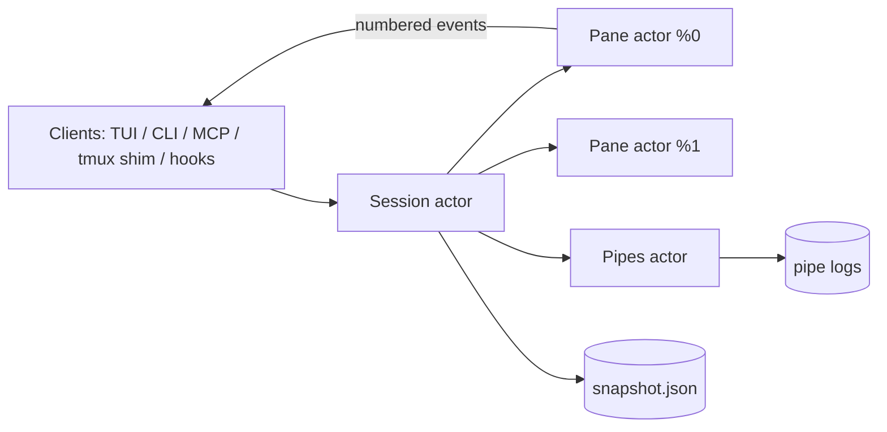

# Architecture & Design

`mpx` is a Rust / Tokio daemon per session, plus thin clients: the TUI, the CLI, the stdio MCP server, and the `tmux` shim. All of them speak the same newline-delimited JSON protocol (`src/protocol.rs`) over a Unix domain socket or Windows Named Pipe.

Inside the daemon, state is owned by **actors**: tokio tasks that each own their data outright and are reached only through messages. Nothing on the request or output path is shared behind a lock.

---

## 1. Actors

- **Session actor** owns:
  - the workspace (windows, split trees, focus history) and the pane registry (name and `%N`);
  - exited-pane history and the idempotency cache;
  - the session snapshot.

  Pane exits arrive on the same mailbox as client requests, so every request sees a consistent layout.
- **Pane actor**, one per pane, owns its process handle, output ring buffer, VT screen, agent state machine, subscribers and pending waits. The blocking PTY reader thread only forwards bytes to it.
- **Pipes actor** owns the virtual pipes, their consumer cursors and the on-disk pipe logs. Pending timed reads are answered by the write that satisfies them or by their deadline.

Every wait is resolved inside the actor that owns the relevant state, with no polling:
- process exit;
- quiet output (a timer reset by output);
- a regex over the screen plus new output;
- an agent state;
- a pipe message.

## 2. Panes

Every pane has a stable id (`%N`):

1. **PTY** (`--pty`): a full terminal (POSIX PTY or ConPTY) mirrored into a VT grid. The grid tracks the program's input modes (cursor keys, bracketed paste, focus events), window title (OSC 0/2) and alerts (BEL, OSC 9/777).
2. **Task**: a child process with captured stdout/stderr and no terminal emulation.

Each pane gets `MPX_ENDPOINT`, `MPX_SESSION`, `MPX_PANE` and `MPX_PANE_ID` in its environment, so programs inside it (agents, scripts, `mpx` itself) address their own session. With tmux compatibility, `TMUX`, `TMUX_PANE` and the shim directory on `PATH` are added.

A pane's exit is reported only after its output has been fully read, so `wait` on exit never races the last bytes a short-lived command printed.

## 3. Event stream

Output is kept in a ring buffer addressed by **absolute byte offsets**. Every `Output` event carries `offset` and `next`, the range of the stream it covers. Multi-byte characters split across reads are held back until complete, so each chunk is valid text and consecutive chunks have contiguous offsets.

- `Subscribe { name, since }`: the pane actor first replays everything from `since`, then switches to live output, atomically. `logs -f` uses this, so history and live output join without a gap or duplicate.
- **Slow subscribers**: each one has a bounded queue. A subscriber that falls behind gets a single `Lagged` event instead of a silent drop, and the pane is never blocked. Clients then re-read what they missed by offset: the TUI rebuilds affected panes, and `logs -f` re-reads from its last offset.
- **Agent events**: every agent state change is pushed as an `Agent` event, so the TUI's waiting badge and notifications update immediately.

## 4. Agent tracking

For each pane, the daemon reads the PTY foreground process (comm and argv) to recognize agent harnesses. It keeps a small state machine (`src/node/agent.rs`):

- Hook reports (`mpx hook`) are authoritative: session id, working / idle / needs input, detail text.
- Terminal alerts move an agent to *needs input*; any input to the pane moves it back to *working*.
- Without hooks, output recency decides *working* versus *idle*. A timer runs only while such an agent is working.

## 5. Workspace

Windows hold binary split trees with ratios. The daemon implements focus history (last pane, last window), swap, break, resize (tmux border semantics), layout presets (even-horizontal, even-vertical, main-vertical, main-horizontal, tiled), sticky window names (set by a rename or given at creation, as with tmux `new-window -n`), and automatic window names from the focused pane's agent or foreground process for windows without one. With `remain_on_exit`, an exited pane stays in the layout with its final screen.

## 6. Durability

State that should outlive the daemon lives in the state directory (`$XDG_STATE_HOME/mpx/<session>/`, see [CONFIG.md](CONFIG.md#state-directory)). The runtime directory holds only the socket.

- **Session snapshot** (`snapshot.json`): windows, layout trees, focus, sticky names, and each running pane's command, live working directory, user environment and agent session id. It is saved atomically (temp file + rename), debounced, after every relevant change, and marked clean only by `kill-server`.
  - If the daemon starts and finds an unclean snapshot (a crash or reboot), it restores before accepting clients: PTY panes rerun their command in their last directory, agents resume their sessions through their harness, and task panes are skipped.
  - `mpx restore` restores on demand.
- **Durable pipes** (`pipes/`): an append-only message log plus metadata (capacity, next sequence number, consumer cursors) per pipe, reloaded on start. A torn last line from a crash is ignored.
- **Idempotency**: `Idempotent { key, request }` runs a request at most once per key. Concurrent repeats wait for the first result and later repeats get it from a bounded cache (1024 keys, 10 minutes). This makes CLI and MCP retries safe for any orchestrator.

## 7. TUI

A mode state machine (normal, prefix, copy, prompt, confirm, overlay) over a per-pane VT mirror:

- **Keymap**: a tmux-notation key → command-line table; config bindings replace or add keys. Commands share one parser with the `:` prompt.
- **Input**: xterm key encoding with modifiers and DECCKM, bracketed paste, and focus events forwarded according to each pane's modes.
- **Stream integrity**: per-pane expected offsets. A gap is filled from the pane's log; `Lagged` rebuilds the panes from their logs.
- **Sessions**: the client can switch daemons (`(`, `)`, tree, agent jumps) without restarting.
- **Overlays**: the agent manager, tree, and help, drawn over the panes.
- **Rendering**: the TUI keeps a shadow of what the terminal shows and each frame sends only the cells that changed, inside a DEC 2026 synchronized update with autowrap disabled. Rows holding non-ASCII glyphs are reprinted whole when they change, since the screen model has no width table; cells under an overlay are repainted when it closes, and a resize repaints everything. Pane colors and bold/italic/underline pass through exactly (basic and bright palette slots are kept apart, and `NO_COLOR` does not strip a program's own colors).

## 8. Cross-platform IPC

| Platform | Transport | Endpoint |
| :--- | :--- | :--- |
| macOS / Linux | Unix Domain Socket | `$XDG_RUNTIME_DIR/mpx/<session>.sock` or `/tmp/mpx-<uid>/<session>.sock` (directory mode 0700) |
| Windows | Named Pipe | `\\.\pipe\mpx-<session>` |

Sessions are discovered by listing that directory (or the pipe namespace). `kill-server` stops the daemon process and removes its socket.
