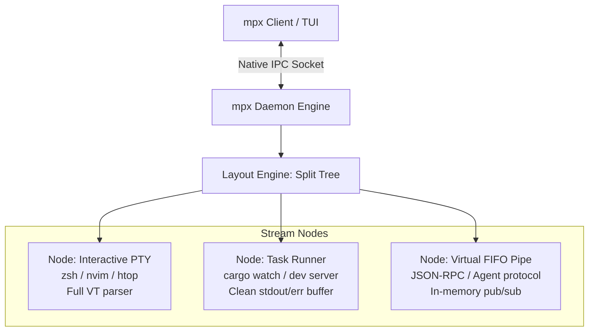

# Architecture & Design

`mpx` is built from first principles in Rust on the Tokio asynchronous runtime to eliminate the architectural friction of legacy terminal multiplexers.

---

## 1. The Paradigm Shift: From "Terminal" to "Stream Node"

Traditional multiplexers treat every pane as an interactive PTY running a login shell. That assumption introduces significant overhead when coordinating task runners, build watchers, and AI agent harnesses.

In `mpx`, every unit is an **Execution Node**:

### Execution Node Modes
1. **`Interactive` (PTY)**: Full ANSI/VT terminal emulator using `portable-pty` (POSIX PTY on macOS/Linux, Windows ConPTY on Windows). Raw mode, cursor addressing, DECSTBM margins, mouse tracking.
2. **`Task` (Pipe Stream)**: Non-PTY child process. Directly captures `stdout`/`stderr` without shell wrappers, tracks process lifecycle, and emits clean line streams.
3. **`Virtual Pipe` (Structured Channel)**: Circular in-memory FIFO channels for cross-agent communication without disk I/O.

---

## 2. Dual-Buffer Engine

To bridge the gap between human visual rendering and machine parsing:

- **Raw Stream Buffer**: An in-memory, thread-safe preallocated ring buffer (`RingBuffer`) storing clean, unescaped output bytes with O(tail) reverse-scanning.
- **2D Virtual Grid**: A compact 2D cell grid driven by the bare `vte` parser state machine. Tracks cursor coordinates, styles, visual selection ranges, and scrollback history.

When an AI agent requests logs via MCP or CLI, it reads the clean stream buffer directly without parsing terminal escape codes. When a human views the pane, the TUI composites the 2D grid.

---

## 3. High-Performance Compositing Pipeline

1. **DEC Mode 2026 Synchronized Updates**: Every frame is wrapped in `\x1b[?2026h` (Begin Synchronized Update) and `\x1b[?2026l` (End Synchronized Update). The outer terminal buffers characters and blits atomically at v-blank, eliminating cursor flicker and line tearing.
2. **DEC Mode ?7l Autowrap Guard**: Line wrapping is disabled (`\x1b[?7l`) on the alternate screen and the bottom status bar is padded to `width - 1`, guaranteeing that bottom-row clock updates never trigger implicit terminal scrolling.
3. **Differential SGR Color Emission**: `render_row_cells` tracks active foreground and background colors, emitting escape sequences only when colors transition. This reduces stdout escape byte volume by ~85%.
4. **Layout Caching**: Split tree layouts and tab geometries are cached in the client, eliminating redundant socket IPC calls during continuous typing or log streaming.

---

## 4. Cross-Platform Native IPC

| Platform | Transport | Endpoint Syntax |
| :--- | :--- | :--- |
| **macOS / Linux** | Unix Domain Socket | `/tmp/mpx-<uid>/<session>.sock` or `$XDG_RUNTIME_DIR/mpx/...` |
| **Windows** | Windows Named Pipe | `\\.\pipe\mpx-<session>` |

Both implementations wrap `tokio::io::AsyncRead + AsyncWrite`, allowing 100% of framing, serialization, and JSON-RPC dispatch to remain platform-agnostic with zero WSL requirement.
