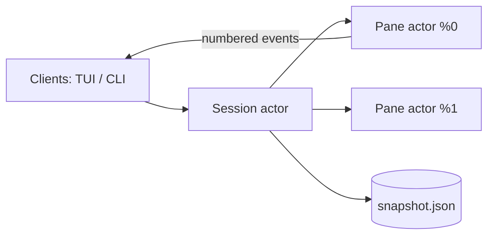

# Architecture & Design

`mpx` is a Rust / Tokio daemon per session, plus thin clients: the TUI and the CLI. All of them speak the same newline-delimited JSON protocol (`src/protocol.rs`) over a Unix domain socket or Windows Named Pipe.

One exception carries the bulk of the traffic: a subscriber that asks for it (`Subscribe { binary: true }`, which the TUI does) and a daemon that answers `BinaryStream` switch that connection to length-prefixed binary frames (`src/wire.rs`), where pane output is raw bytes instead of escaped JSON; other events stay JSON inside their frame.

Inside the daemon, state is owned by **actors**: tokio tasks that each own their data outright and are reached only through messages. Nothing on the request or output path is shared behind a lock. Every mpx process runs its tasks on a single thread to eliminate cross-thread wakeups and maximize throughput.

---

## 1. Actors

- **Session actor** owns:
  - the workspace (windows, split trees, focus history) and the pane registry (name and `%N`);
  - exited-pane history and the idempotency cache;
  - the session snapshot.

  Pane exits arrive on the same mailbox as client requests, so every request sees a consistent layout. Requests that take time (log reads, waits, and kills) resolve their pane through the session and talk to it directly, ensuring no requests block the session actor.

- **Pane actor**, one per pane, owns its process handle, output ring buffer, VT screen, subscribers, and pending waits. The blocking PTY reader thread forwards bytes directly to it.

Every wait is resolved inside the actor that owns the relevant state without polling:
- process exit;
- quiet output (a timer reset by output);
- a regex over the screen plus new output.

---

## 2. Panes

Every pane has a stable id (`%N`):

1. **PTY** (`--pty`): a full terminal (POSIX PTY or ConPTY) mirrored into a VT grid. The grid tracks the program's input modes (cursor keys, bracketed paste, focus events), window title (OSC 0/2) and alerts (BEL).
2. **Task**: a child process with captured stdout/stderr and no terminal emulation.

Each pane gets `MPX_ENDPOINT`, `MPX_SESSION`, `MPX_PANE`, `MPX_PANE_ID`, `TMUX`, and `TMUX_PANE` in its environment.

A pane's exit is reported only after its output has been fully read, so `wait` on exit never races the last bytes a command printed.

## Windows, links and sessions

A session's layout is a list of **indices** (`Link`s), each showing a **window** (its panes, split tree, focus and size). A window can be shown at several indices of the same session (`link-window`), and every such index shows the same panes: the panes belong to the window, not to the index. The session saves a window linked at several indices once, and the other indices point at that entry (`shares`); restore spawns its panes once and shows the window at each saved index.

Windows never cross sessions. Each session is its own daemon, with its own panes, state directory and socket, so a window of one session cannot be shown in another. `link-window`, `link-window -t`, and the window arguments of `unlink-window` and `resize-window` accept `N` or `session:N` of the session the command runs in and refuse any other session (`window ... is in another session`). Session groups (`new-session -t`) are refused for the same reason.

---

## 3. Event Stream

Output is kept in a ring buffer addressed by **absolute byte offsets** (the last 2 MB per pane). It is the single source of scrollback: live screens, in the daemon and in the TUI, keep only what is on screen, so floods cost no history work. Copy mode and plain log reads rebuild scrollback on demand by replaying the ring into a fresh screen at the pane's size. A resize records the offset it happened at (`resized_at`): output before it replays at the size the pane had, the screen then resizes, and output after it replays at the new size, as the live pane took it. Every `Output` event carries `offset` and `next`, the range of the stream it covers. Multi-byte characters split across reads are held back until complete.

- `Subscribe { name, since }`: the pane actor first replays everything from `since`, then switches to live output atomically. `logs -f` uses this so history and live output join seamlessly without duplicate bytes.
- **Pacing** (`src/node/pacing.rs`): output flows at the speed it can be shown, as in a real terminal, so a flood never queues ahead of a keystroke's echo.
- **Only what is on screen**: the TUI subscribes with `active_window`, so of pane output it receives only the active window's. Busy panes in other windows cost the TUI nothing.
- **Layout events**: a subscriber that asks for them gets a `Layout` event whenever windows or panes are rearranged by anyone (a focus change, window switch, split, swap, or resize).

---

## 4. Durability & Recovery

State that outlives the daemon lives in the state directory (`$XDG_STATE_HOME/mpx/<session>/`). The runtime directory holds only the socket.

- **Session snapshot** (`snapshot.json`): windows, layout split trees, focus, sticky window names, the session environment, and each running pane's command, live working directory, user environment, and resume rule. It is saved atomically (temp file + rename), debounced, after every change, and marked clean on `kill-server`.
  - If the daemon starts and finds a snapshot (after a crash, a reboot or `kill-server`), it restores the layout before accepting clients, unless `restore = false` or the daemon was started with `--no-restore`.
  - PTY panes re-run their command in their last directory. Panes matching `[[resume]]` rules expand their resume command or fallback (e.g. `claude --resume {id}`, `omp --restore {id}`, `nvim -c 'silent! source Session.vim'`).
  - `mpx restore` restores on demand.
- **Idempotency**: `Idempotent { key, request }` runs a request at most once per key. Concurrent repeats wait for the first result and later repeats get it from a bounded cache (1024 keys, 10 minutes).

---

## 5. TUI

- **DEC 2026 Synchronized Updates**: zero-flicker redraws.
- **Vi Copy Mode**: 100k-line scrollback, regex search, visual selection, and OSC 52 system clipboard synchronization.
- **Command Palette (`Ctrl-Space`)**: instant fuzzy search across Commands, Sessions & Windows, and Keybindings.
- **Popups and menus**: `display-popup` runs a command on its own pty in a box over the panes; `display-menu` opens window and pane menus on `Prefix <` and `Prefix >`.
- **Outer terminal**: focus events, titles (`set-titles`) and bells (`bell-action`, `visual-bell`) follow their options (see [CONFIG.md](CONFIG.md)); hyperlinks (OSC 8), underline styles and synchronized output pass through.
